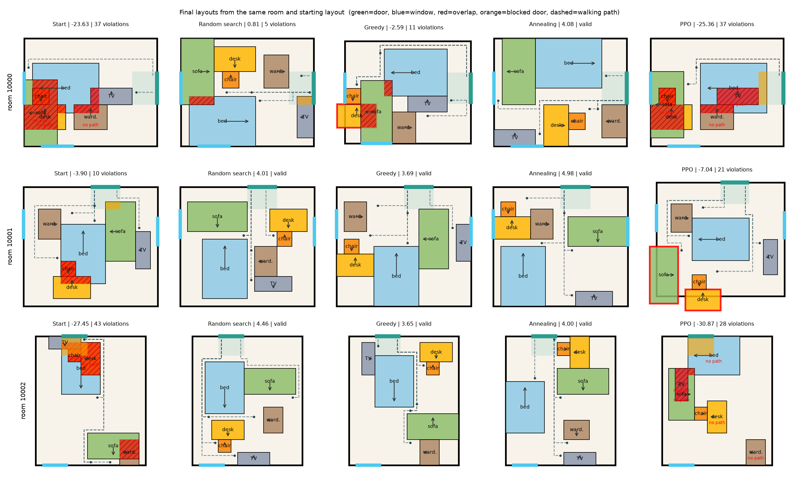
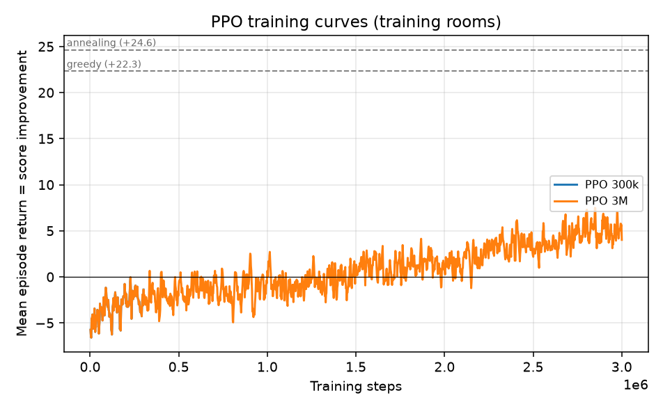

# Furniture Layout Optimization: Random Search vs Greedy vs Simulated Annealing vs PPO

A from-scratch comparison of four ways to arrange furniture in a room, all scored by the
**same** reward function, on rooms and starting layouts none of the methods were tuned on.

**Short version:** simulated annealing, which has no learning at all, clearly won. PPO
(reinforcement learning) failed my pre-registered success criteria in both runs (300k and 3M
training steps). 10x more training turned "no learning" into a real but partial improvement,
still far from producing valid layouts. This repository documents what I built, what I
measured, and why.



## Results (50 unseen test rooms)

All four methods start each room from the *same* layout. Search methods get a budget of
5,000 reward evaluations per room. Scores: higher is better, about 5.0 is the maximum.
"Valid" = no overlaps, nothing outside the room, door clear, every piece reachable.

| Algorithm | Mean score | Std | Valid layouts | Evals per room | Seconds per room* |
|---|---|---|---|---|---|
| Random search | 1.09 | 3.64 | 21/50 | 5,000 | 0.75 |
| Greedy hill climbing | 1.51 | 3.84 | 28/50 | 635 | 0.09 |
| **Simulated annealing** | **3.84** | **1.67** | **42/50** | 5,000 | 0.69 |
| PPO, 300k steps (pre-registered run) | -20.59 | 9.21 | 0/50 | 81 | 0.02 |
| PPO, 3M steps (exploratory, chosen after the first result) | -16.57 | 8.94 | 0/50 | 127 | 0.03 |

\*Measured on a MacBook Air (CPU only). PPO also paid a one-time training cost: 85 s for 300k
steps and 941 s for 3M steps. PPO rows use deterministic (argmax) actions.
Starting layouts average -20.80.

**Paired comparison** (same rooms, same starts; 95% bootstrap CI on the mean difference):

| First vs second | First wins | Second wins | Mean diff [95% CI] |
|---|---|---|---|
| Annealing vs random search | 46 | 4 | +2.75 [+2.09, +3.44] |
| Annealing vs greedy | 48 | 2 | +2.33 [+1.58, +3.18] |
| Greedy vs random search | 30 | 20 | +0.42 [-0.20, +1.00] (not clearly different) |
| PPO 3M vs annealing | 0 | 50 | -20.42 [-22.71, -18.10] |
| PPO 3M vs PPO 300k | 30 (1 tie) | 19 | +4.02 [+1.49, +6.61] |

Greedy's advantage over random search in *score* is not statistically clear, but it reaches
it with about one eighth of the evaluations.

### PPO experiments

Before training I wrote down success criteria: a **full win** is mean >= 3.8 and >= 40/50 valid;
a **useful trade-off** is mean >= 2.0 and >= 30/50 valid; anything below is a **loss**.
The 300k-step run was a **loss** (table above). I then diagnosed it and trained longer.
The 3M-step run was chosen *after* seeing the first result, so it is exploratory. I compared
the two on 20 separate **validation** rooms (sampled actions, unless noted), then ran the
test rooms once on the 3M model:

| Validation rooms (20) | Mean score | Improvement over start | Valid |
|---|---|---|---|
| Starting layouts | -20.07 | - | 0/20 |
| PPO, 300k steps | -22.23 | -2.2 | 0/20 |
| PPO, 3M steps | -12.80 (argmax: -14.05) | +7.3 (argmax: +6.0) | 0/20 |
| Random search / greedy / annealing | 0.72 / 1.38 / 3.31 | +20.8 / +21.5 / +23.4 | 7 / 10 / 15 of 20 |

**The 3M run also missed the criteria** (mean -16.57, 0/50 valid). It still improved on the 300k
run in 30 of 50 test rooms (paired mean +4.02, 95% CI [+1.49, +6.61]), so the extra training did
something real. On the test rooms it improved layouts by about +4.2 points over their starting
layouts (average -20.80); annealing improved them by about +24.6. The validation and test gains
differ partly because they are different rooms and because validation also reported sampled
actions, so I would not read much into the gap between +6 and +4.

**Cost:** 3M steps took 941 s. Annealing needs 0.69 s per room, so even ignoring quality, PPO's
training would only pay for itself after roughly 1,350 rooms, and it never reached annealing's
quality here.



## Problem and environment

A 2D grid room (0.25 m cells, 3 to 5 m per side) with a door and 1 or 2 windows, and five movable
pieces (bed, wardrobe, desk, sofa, TV stand). A chair is **tied to the desk** (always placed in
front of it), so the agent controls 5 pieces and the room contains 6.

- **State:** room size, door, windows, and each piece's position, rotation and footprint
  (63 numbers). An optional 20x20 occupancy grid can be added.
- **Actions (31):** for each of the 5 pieces, move up/down/left/right or rotate either way (30),
  plus FINISH.
- **Reward:** the change in layout score after each move (potential-based), so an episode's total
  reward equals final score minus starting score, and moving a piece back and forth earns nothing.

## The reward function

One function (`environment/reward.py`) scores every layout. Total = soft bonuses - hard penalties.

| Hard penalties (per unit, dense) | Weight |
|---|---|
| Each overlapping cell | 0.5 |
| Each cell outside the room | 0.5 |
| Each blocked cell in front of the door | 1.0 |
| Each piece unreachable from the door (BFS) | 3.0 |

| Soft bonuses (each in [0, 1]) | Weight |
|---|---|
| Desk near a window | 1.0 |
| Sofa and TV face each other | 1.0 |
| Sofa-to-TV distance 1.5 to 3 m | 0.5 |
| Bed near wardrobe | 0.5 |
| Free space in front of bed, wardrobe, desk, sofa | 1.5 |
| Directness of the walking path from the door | 0.5 |

Penalties are charged per cell on purpose: out of 1,000 random layouts only 1 was valid, so a
sparse "perfect or nothing" reward would give a learner almost no signal. The design rule against
reward hacking: *what a violation can buy must cost more than it gains.* Known gaps I did not
close: no line-of-sight check between sofa and TV, and a desk may block a window.

## The four algorithms

1. **Random search:** sample random layouts, keep the best. Ignores the starting layout.
2. **Greedy:** try all legal single moves, take the best one if it improves the score, otherwise
   stop (a local optimum). Ties broken at random. No restarts.
3. **Simulated annealing:** accept improvements always and worse moves with probability
   exp(delta / T). Temperature cools geometrically from 1.0 to 0.02; 80% of proposals are
   translations, 20% rotations. Returns the best layout visited.
4. **PPO** (Stable-Baselines3): MLP policy and value networks (128x128), trained on 200 training
   rooms, then run without exploration on unseen rooms.

## Evaluation protocol

- Rooms come from seeds: training 0-199, validation 20000-20019, test 10000-10049. The pools
  never overlap (a test checks this).
- Every algorithm starts each test room from the identical (room, initial layout) pair.
- Search methods share one budget (5,000 `evaluate_layout()` calls), enforced by a counting
  wrapper they cannot bypass. Wall-clock time and PPO's training cost are reported separately.
- Success criteria were fixed before PPO was trained.
- Paired per-room differences with bootstrap confidence intervals, not just mean and std.

## What I learned and what was hard

- **Local optima are real.** In test room 10003 greedy stalled at 2.27 because every first step
  toward the better arrangement lowered the score; annealing crossed the valley and reached 4.67.
- **A degenerate-policy trap in my own reward.** Pressing FINISH on step 1 scores exactly 0,
  while random play for 200 steps averages -9.4, so a fresh policy is rewarded for quitting. I
  measured this before training and added a guard that refuses FINISH before step 50.
- **PPO needed far more than 300k steps, and 3M was still not enough.** 300k steps left layouts
  slightly worse than the start on validation; 3M steps improved them (about +6 to +7 on
  validation, +4.2 on test) but produced no valid layout. Its training reward was still rising at
  3M steps, so I cannot say where it would plateau. I diagnosed the first run with training logs
  and by comparing argmax against sampled actions (it was not an argmax problem).
- **Fair comparison takes work:** shared budget, shared starts, held-out rooms, and
  honest accounting for PPO's training cost. A caveat I noticed in my own baseline: random search
  "teleports" every piece, while the other methods move one piece one cell at a time.
- **Eight test rooms had no valid layout from any method.** All are small (12-15 by 12-17 cells),
  which is consistent with being too small, but I have not proven they are infeasible.

## Limitations

- One training seed per PPO configuration and 50 test rooms; each PPO result is a single run.
- PPO was tried with a flat-vector observation only in the reported runs. I added an optional
  occupancy-grid observation (`--obs-mode grid`) but did not have time to train and evaluate it.
- The PPO observation is a flat vector, so the network must infer overlaps from coordinates.
- 2D grid only; fixed catalog of five pieces; hand-set reward weights.
- Reward weights were not systematically tuned.

## Reproduce

```bash
python -m venv venv && source venv/bin/activate
pip install -r requirements.txt
pytest

python -m evaluation.run_random_search
python -m evaluation.run_greedy
python -m evaluation.run_annealing

python -m algorithms.ppo --timesteps 300000          # about 1.5 minutes
python -m evaluation.run_ppo                         # writes results/ppo.json

python -m algorithms.ppo --timesteps 3000000 --run-name long3m   # about 15 minutes
python -m evaluation.run_ppo --model models/long3m/ppo_final.zip \
    --label "PPO 3M" --out ppo_long3m.json

python main.py compare --ppo "ppo=PPO 300k" "ppo_long3m=PPO 3M"
python main.py figures --ppo-model models/long3m/ppo_final.zip \
    --ppo "ppo_long3m=PPO 3M"
```

## Project structure

```
config.py                 all tunable numbers
main.py                   compare / figures commands
environment/              room, furniture, layout, pathfinding (BFS), reward, Gymnasium env
algorithms/               random_search, greedy, simulated_annealing, ppo, shared base
evaluation/               run_* scripts, paired statistics, diagnostics, success criteria
visualization/            Matplotlib renderer and plots
tests/                    pytest suite
results/                  per-room results, comparison.md, figures/
```

## Development notes

Built with Claude (Anthropic) as a coding partner and mentor. The design decisions were mine:
cell size, chairs tied to desks, per-cell penalties, step-by-step actions, score-difference
rewards, the evaluation budget and the success criteria.

MIT licensed.
